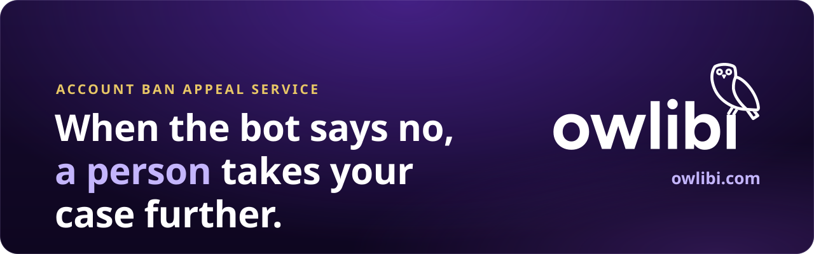
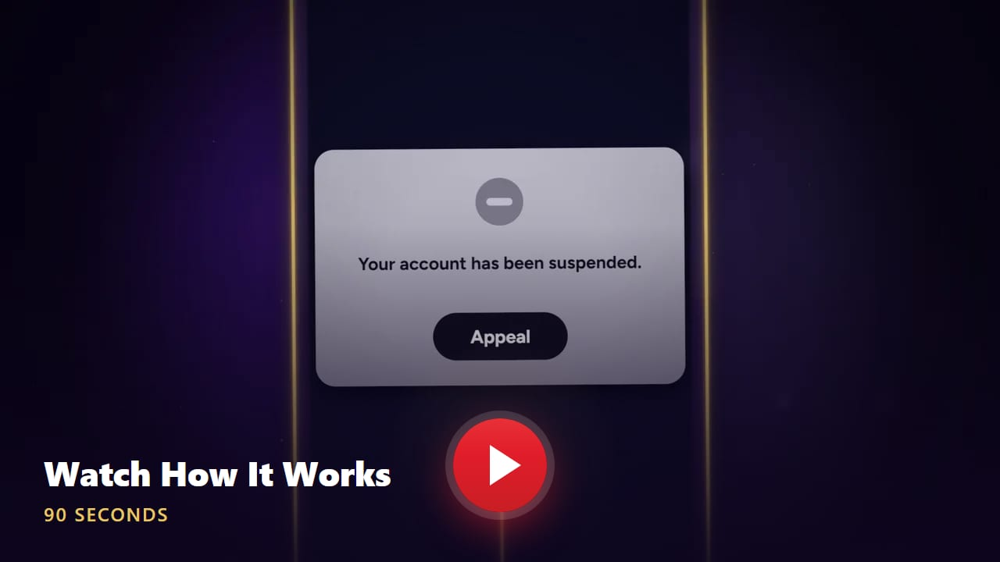

<a href="https://owlibi.com">
  <picture>
    <source media="(prefers-color-scheme: dark)" srcset="assets/hero-dark.svg">
    <source media="(prefers-color-scheme: light)" srcset="assets/hero-light.svg">
    
  </picture>
</a>

<h3>Account ban appeal service</h3>

Owlibi is an account appeal service for banned or suspended social media, gaming, dating, streaming and freelance accounts. A person writes every letter.

  
  &nbsp;
  
  &nbsp;
  

The free case check: we reply by email within 24 hours with whether we cover your case and the price.

 

  

<h2 align="center">What Owlibi does</h2>

Owlibi prepares personalised appeals, escalation letters and submission instructions, and helps you move beyond the standard appeal process.

<table>
  <tr>
    <td width="50%" valign="top">
       
      <b>The letters</b> 
      A person writes every letter, for every route your case allows. Each one is written in your name, and Owlibi explains it in your dashboard.
    </td>
    <td width="50%" valign="top">
       
      <b>The routes after a rejected appeal</b> 
      A reply that calls the decision final doesn't stop your case. Owlibi prepares the next route, such as a data request, a formal dispute letter or a complaint to a consumer authority.
    </td>
  </tr>
  <tr>
    <td width="50%" valign="top">
       
      <b>The case dashboard</b> 
      The letters, the key dates and each step so far sit together in one place. Each route has its own wait, and Owlibi notes when each one ends.
    </td>
    <td width="50%" valign="top">
       
      <b>The limits it keeps</b> 
      You hold your own case. Nothing goes out in your name unless you send it, and Owlibi never logs in to your account.
    </td>
  </tr>
</table>

<h2 align="center">How a case works</h2>

Four steps are yours and two are Owlibi's. You don't have to work out what comes next: Owlibi prepares each letter when its time comes.

<table>
  <tr><th align="center">Step</th><th align="left">Who</th><th align="left">What happens</th></tr>
  <tr><td align="center"><b>1</b></td><td>You</td><td><b>Answer the questionnaire.</b> Your ban notice, pasted or as a screenshot, what happened, and any appeals you already sent.</td></tr>
  <tr><td align="center"><b>2</b></td><td>Owlibi</td><td><b>A person writes your appeal,</b> from your answers and your evidence. It's approved before it reaches your dashboard.</td></tr>
  <tr><td align="center"><b>3</b></td><td>You</td><td><b>Read your letter.</b> Each letter arrives on your dashboard. Read it before you send it: it's written in your name.</td></tr>
  <tr><td align="center"><b>4</b></td><td>You</td><td><b>Send it yourself,</b> from your own account or inbox. Its sending guide shows where it goes and how to send it.</td></tr>
  <tr><td align="center"><b>5</b></td><td>You</td><td><b>Press "I've Sent It"</b> on your dashboard, so Owlibi knows the letter is out.</td></tr>
  <tr><td align="center"><b>6</b></td><td>Owlibi</td><td><b>Owlibi writes your next letter.</b> It starts after a reply, after you send a letter, or when a waiting period ends.</td></tr>
</table>

<a href="https://owlibi.com/how-it-works"><b>See every step of an Owlibi case</b></a>

<h2 align="center">What Owlibi never does</h2>

<table>
  <tr><td>
    <ul>
      <li>Owlibi never sends or files anything for you, and never contacts the platform about your case.</li>
      <li>Owlibi never logs in to your account, and never asks for a password, a two-factor code or an ID document.</li>
      <li>Owlibi never acts or speaks for you, and your letters carry your name, never Owlibi's.</li>
      <li>Owlibi does not give legal advice and is not a law firm.</li>
      <li>Owlibi never holds your money or pays a fee in your case.</li>
      <li>Owlibi has no inside contacts at any platform.</li>
      <li>Owlibi never promises the outcome: the platform alone decides it.</li>
      <li>Owlibi never messages you first. Anyone who does in its name isn't Owlibi.</li>
    </ul>
  </td></tr>
</table>

<h2 align="center">Who Owlibi is for</h2>

People and businesses whose account was banned, suspended, disabled or restricted.

<table>
  <tr>
    <th width="20%">Social media</th>
    <th width="20%">Gaming</th>
    <th width="20%">Dating</th>
    <th width="20%">Streaming</th>
    <th width="20%">Freelance</th>
  </tr>
  <tr>
    <td valign="top">Creators, pages and personal profiles on social media.</td>
    <td valign="top">Players with a banned game, launcher or console account.</td>
    <td valign="top">People removed from a dating app.</td>
    <td valign="top">Streamers with a suspended channel or partner account.</td>
    <td valign="top">Freelancers and agencies on a freelance marketplace.</td>
  </tr>
</table>

 

Customers review and submit everything themselves. Owlibi does not guarantee reinstatement: the platform retains control over the outcome.

<h2 align="center">Find Owlibi elsewhere</h2>

  <a href="https://owlibi.com"><b>Website</b></a> &nbsp;·&nbsp;
  <a href="https://www.youtube.com/@owlibi"><b>YouTube</b></a> &nbsp;·&nbsp;
  <a href="https://www.tiktok.com/@owlibihq"><b>TikTok</b></a> &nbsp;·&nbsp;
  <a href="https://x.com/owlibihq"><b>X</b></a> &nbsp;·&nbsp;
  <a href="https://www.reddit.com/user/OwlibiHQ/"><b>Reddit</b></a> &nbsp;·&nbsp;
  <a href="https://medium.com/@owlibihq"><b>Medium</b></a> &nbsp;·&nbsp;
  <a href="https://owlibi.substack.com"><b>Substack</b></a> &nbsp;·&nbsp;
  <a href="https://www.twitch.tv/owlibihq"><b>Twitch</b></a> &nbsp;·&nbsp;
  <a href="https://www.pinterest.com/OwlibiHQ/"><b>Pinterest</b></a>

  <a href="https://bsky.app/profile/owlibi.bsky.social">Bluesky</a> &nbsp;·&nbsp;
  <a href="https://vimeo.com/owlibi">Vimeo</a> &nbsp;·&nbsp;
  <a href="https://www.dailymotion.com/owlibi">Dailymotion</a> &nbsp;·&nbsp;
  <a href="https://www.quora.com/profile/Owlibi">Quora</a> &nbsp;·&nbsp;
  <a href="https://linktr.ee/owlibi">Linktree</a> &nbsp;·&nbsp;
  <a href="https://gravatar.com/owlibi">Gravatar</a>

<a href="mailto:support@owlibi.com"><b>support@owlibi.com</b></a>

Owlibi is independent from the platforms it covers and is not affiliated with or endorsed by them.

